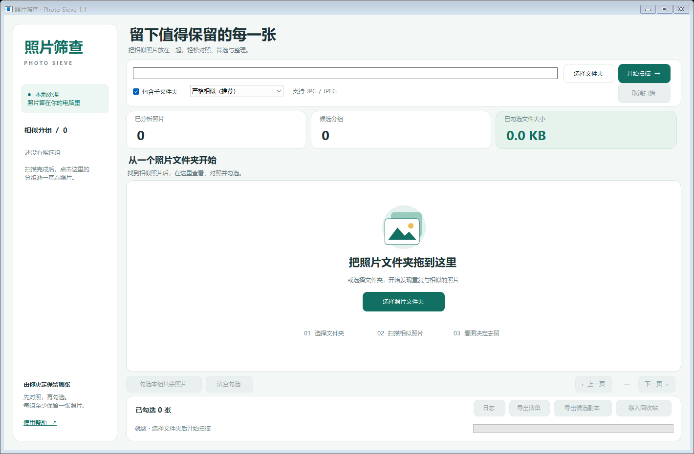
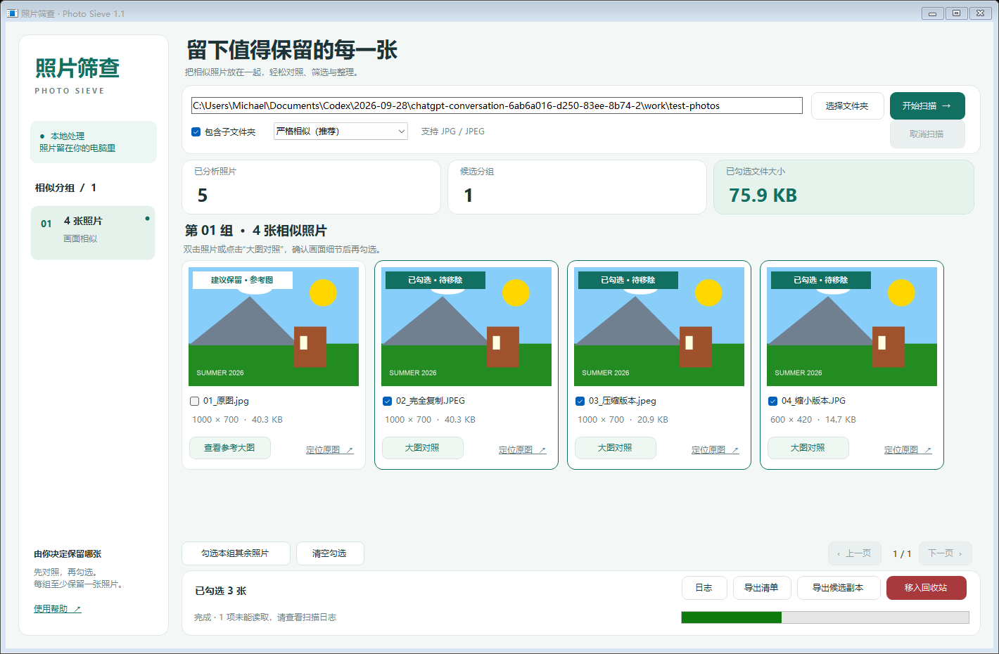
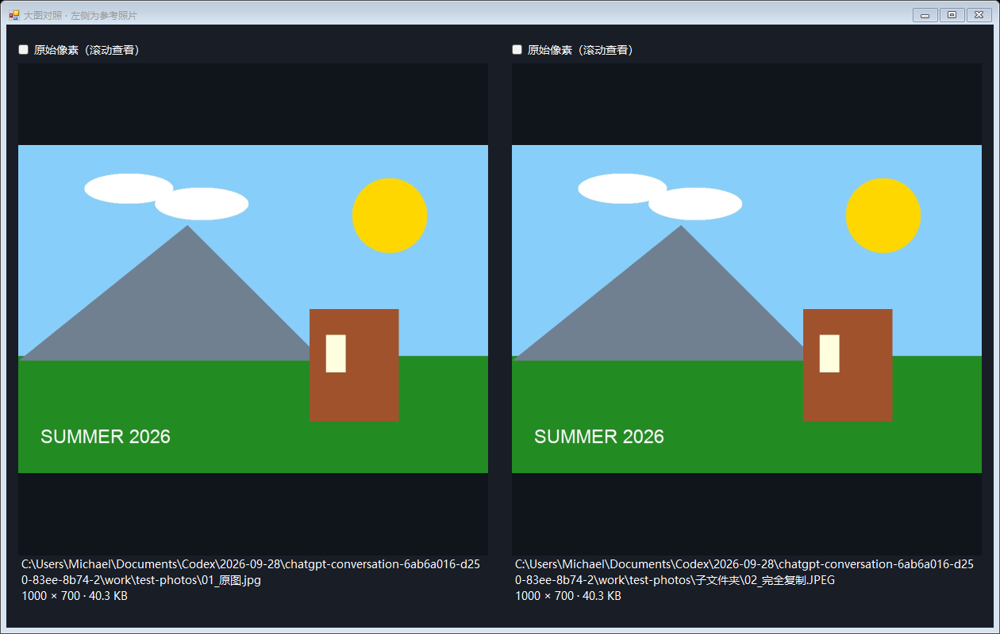

# Similar-Photo-selection · 照片筛查 (Photo Sieve)

Windows 本地 JPEG 重复 / 相似照片筛查工具。选择一个文件夹，程序按画面相似度把照片分组，显示缩略图和大图对照，由你手动决定删除哪些。

- 纯本地运行，不联网、不上传照片
- 单个 EXE，无需安装 Python，使用 Windows 自带的 .NET Framework 4.x
- 不会自动删除：只有手动勾选并确认后才移入回收站，且每组至少保留一张





## 下载与运行

直接下载 [`release/照片筛查.exe`](release/照片筛查.exe) 双击运行（Windows 10 / 11）。程序未签名，首次运行时 Windows 可能弹出 SmartScreen 提示。

详细说明见 [docs/使用说明.txt](docs/使用说明.txt)。

## 匹配模式

| 模式 | 说明 |
| --- | --- |
| 仅完全重复 | 文件内容 SHA-256 相同 |
| 严格相似（推荐） | 综合感知哈希、差异哈希、宽高比和平均颜色 |
| 一般相似 / 宽松相似 | 允许更多差异，误报也会增多 |

- 支持 `.jpg` / `.jpeg`（扩展名不区分大小写），会处理 EXIF 方向信息
- 每组成员都直接与参考图比较，不依赖逐张相似的连锁关系
- 可"导出候选副本"：按组复制照片并生成 `原始路径对照.csv`，不改动原图

## 局限

相似不等于重复，这是辅助人工筛查的工具。大幅裁剪、旋转、重度滤镜可能漏检；内容很简单的画面可能误报。不支持 HEIC、RAW、PNG 和视频。

## 从源码构建

```powershell
cd src
powershell -ExecutionPolicy Bypass -File .\build.ps1
```

使用系统自带的 `csc.exe`（.NET Framework 4.0.30319），无需安装 Visual Studio。测试程序的编译和运行方法见 [src/TESTING.txt](src/TESTING.txt)；`tests/orientation-test` 是可选的 EXIF 方向测试素材。

## 目录结构

```
src/        C# 源代码、构建脚本、测试程序
release/    编译好的 照片筛查.exe (v1.1)
docs/       使用说明和界面截图
tests/      EXIF 方向测试图片
```

本项目由 Claude 和 Codex 协助开发。
